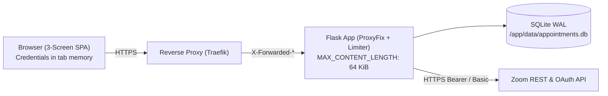
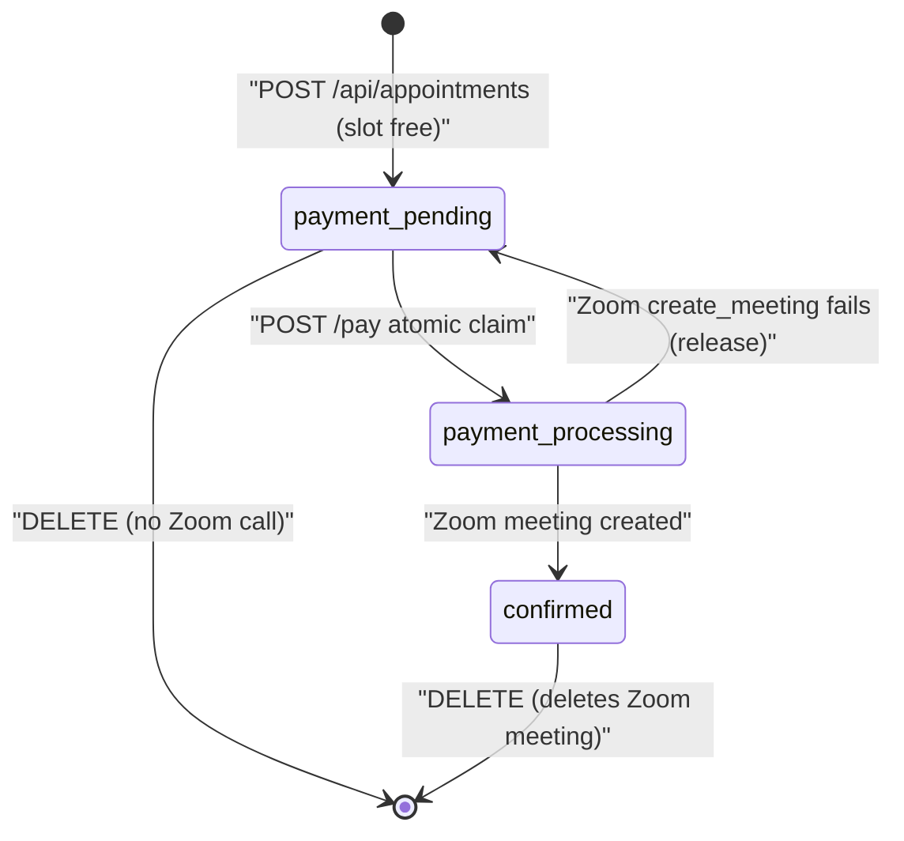

# Architecture — `zoom-sched-poc`

Canonical present-state architecture for the **zoom-sched-poc** proof-of-concept (`feat/zoom-sched-poc`).

## System Topology

Single-container Flask + Gunicorn (`--workers 1 --threads 4`) application serving both the static 3-screen presentation UI and the JSON REST API behind a reverse proxy (Traefik).

## Module Responsibilities

| Module | Responsibility |
| :--- | :--- |
| [`app/__init__.py`](app/__init__.py) | App factory (`create_app`), `ProxyFix`, `Flask-Limiter` (`memory://`), `_resolve_appointment`, HTTP routes, and error handlers (`413`, `429`, `ZoomAPIError`). |
| [`app/schemas.py`](app/schemas.py) | Pydantic v2 request/response models; `ZoomCredentials.client_secret` uses `SecretStr`. |
| [`app/db.py`](app/db.py) | SQLite WAL initialization (`init_db`) and atomic state transitions (`create_appointment`, `claim_appointment_for_payment`, `release_payment_claim`, `mark_appointment_confirmed`, `delete_appointment`). |
| [`app/zoom.py`](app/zoom.py) | Zoom Server-to-Server OAuth token exchange, paginated slot conflict detection (`max_pages=20`), meeting creation, and meeting deletion. |
| [`app/templates/index.html`](app/templates/index.html) & [`static/style.css`](static/style.css) | 3-screen smooth-scroll presentation UI with `escapeHtml()` and `safeHttpUrl()` (`http:`/`https:` only). |

## Appointment State Machine

## Trust Boundaries & Rate Limits
- **Zoom credentials (`account_id`, `client_id`, `client_secret`)** are never written to SQLite, cookies, or disk; they are validated per request on `/api/zoom/verify-credentials`, `/api/appointments`, `/pay`, and `DELETE`.
- **Host ZAK link (`zoom_start_url`)** is omitted on unauthenticated `GET /api/appointments/<lookup_id>` and returned only by `POST /pay` after credential verification.
- **Brute-force rate limits** (`Flask-Limiter` `memory://` in a single Gunicorn worker): `60/min` default, `10/min` on `/verify-credentials`, `/pay`, and `DELETE`, `15/min` on `POST /api/appointments`, `20/min` on `GET /api/appointments/<lookup_id>`.
